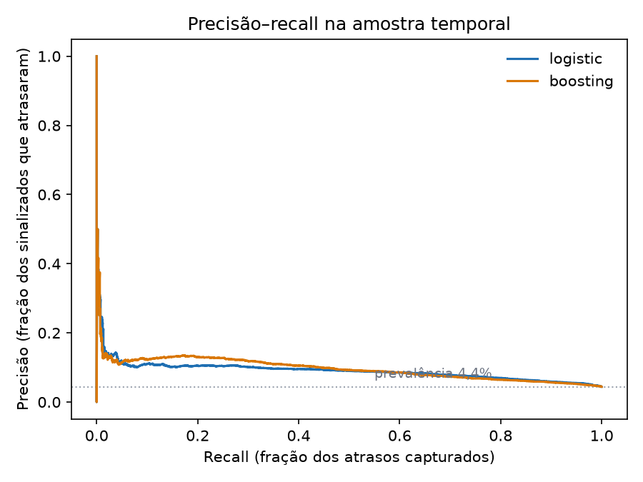
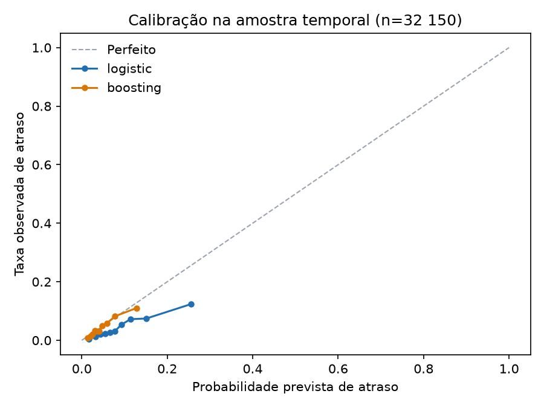

Este é o segundo projeto sobre o conjunto de dados de e-commerce brasileiro da
Olist. O [primeiro](../01-retail-analytics/01-business-analytics.qmd) mostrou que
o atraso na entrega é o sinal mais forte de insatisfação do cliente no
marketplace e que o atraso se concentra na rota São Paulo → Rio. Este projeto
faz a pergunta voltada para a frente: **no momento em que o pedido é feito, é
possível ordenar os pedidos pelo risco de chegar atrasado?**

Todo número abaixo vem de `projects/02-late-delivery`, treinado sobre o mart dbt
`mart_order_features`. O modelo treinado não é versionado; as métricas e figuras
são, e `uv run python tasks.py train` as reconstrói.

---

## Resumo executivo

- **O ranking tem sinal, mas é moderado e instável entre períodos.** Em uma
  amostra temporal de 32.150 pedidos entregues, o modelo logístico selecionado
  alcança **ROC AUC 0,708** (intervalo bootstrap de 95%: 0,695–0,720) e
  **precisão média 0,091** (0,083–0,101) contra uma taxa de atraso de 4,42%.
  Sinalizar os 10% de maior risco captura **23,5% dos atrasos** com
  **precisão de 10,4% — 2,35× a taxa base**.
- **A classe do modelo não está decidida por esta evidência.** A regressão
  logística venceu um período interno de validação por precisão média, mas o
  gradient boosting foi levemente melhor na amostra final (precisão média 0,097
  contra 0,091; recall no decil superior 28,4% contra 23,5%). A diferença é
  pequena e uma única amostra temporal não estabelece um ranking confiável entre
  os dois. O relatório mostra ambos em vez de declarar um vencedor a partir do
  teste.
- **O score é uma fila de triagem, não uma probabilidade.** A taxa de atraso da
  amostra é 4,42%, enquanto a previsão média do modelo selecionado é 6,38%. A
  inclinação de calibração é próxima de um (1,02), mas o intercepto é −0,35 na
  escala logit: o modelo ordena razoavelmente e superestima o nível. Uma
  probabilidade em produção precisaria ser recalibrada com pedidos recentes e
  maduros.
- **Prazo e geografia dominam.** A importância por permutação coloca
  `promise_days` em primeiro lugar, seguido de `customer_state` e `seller_state`. Valor, frete, peso, pagamento e categoria acrescentam pouco
  depois disso.
- **O resultado não é uma alavanca causal.** `promise_days` é a própria
  expectativa do marketplace sobre a dificuldade. Encurtá-lo não reduziria o
  atraso mecanicamente; a pergunta operacional do Projeto 01 sobre o corredor São
  Paulo → Rio continua sendo a causal.

---

## 1. O contrato de atributos

O modelo só pode usar informação que existe quando o pedido é feito. Isso é
garantido por uma lista explícita de atributos permitidos em
`projects/02-late-delivery/src/late_delivery/features.py`, e não por descartar
algumas colunas óbvias: uma nova coluna do mart falha fechada até alguém
adicioná-la de propósito.

| Grupo | Atributos |
|---|---|
| Momento da compra | mês, dia da semana, hora, indicador de fim de semana |
| O prazo | `promise_days` (data prometida − data da compra) |
| Geografia | estado do cliente, estado do vendedor, indicador de mesmo estado |
| Composição do pedido | categoria, número de itens / produtos / vendedores, valor dos itens, frete, valor do pedido, participação do frete, peso, volume, fotos, dimensões ausentes |
| Pagamento | número de pagamentos, máximo de parcelas, indicadores de cartão / boleto / voucher |

Ficam de fora, deliberadamente: horário de aprovação, entrega à transportadora,
data de entrega, duração da entrega, dias de atraso, o próprio rótulo, a nota da
avaliação e o status do pedido. Todos são observados depois do checkout. O tempo
de chegada preveria o atraso quase perfeitamente, e é exatamente por isso que
incluí-lo tornaria o resultado inútil como previsão e impossível de usar no
momento da decisão.

`order_status` e `delivered_to_customer_at` existem no mart apenas para decidir
se o rótulo de treino era observável no corte. Eles são proibidos na matriz de
atributos, e um teste unitário garante isso.

Duas consequências aparecem no mart. `seller_state` é nulo em 1.285 pedidos com
mais de um vendedor, porque um pedido multi-vendedor não tem uma origem única;
`same_state` é nulo nas mesmas linhas. Ambos são imputados dentro do pipeline, não
adivinhados. Para pedidos com várias categorias, o mart mantém a categoria mais
frequente e desempata alfabeticamente.

---

## 2. Desenho da avaliação

**Alvo:** `is_late`, definido no Projeto 01 como a data de entrega
estritamente posterior à data prometida. Pedidos sem data de entrega observada
não têm rótulo e ficam de fora. Isso não é o mesmo que “nunca entregue”: os 2.965
pedidos excluídos estão majoritariamente em trânsito ou cancelados no fim do
conjunto (1.107 enviados, 619 cancelados, 609 indisponíveis, 314 faturados, 301
em processamento, 8 entregues com data incompleta e alguns status anteriores).

**Divisão:** compras antes de **2018-04-01** formam o período de treino; compras
a partir dessa data formam o teste (32.150 pedidos, 4,42% atrasados). Uma divisão
aleatória colocaria os mesmos meses dos dois lados e deixaria o modelo aprender
um backlog específico em vez de um padrão.

**Maturação do rótulo:** um pedido de treino precisa ter sido comprado e entregue
antes do corte. Sem essa regra, 3.852 pedidos comprados antes de abril mas
entregues depois contribuiriam com rótulos que não existiam na data de
implantação. O conjunto de treino maduro tem **60.474 pedidos e taxa de atraso de
5,97%**.

**Seleção de modelo:** o período de treino é dividido novamente em
**2018-01-01**. Os modelos são ajustados antes dessa data (41.202 pedidos) e
comparados em janeiro–março de 2018 (16.783 pedidos, 6,91% atrasados). A
precisão média seleciona a regressão logística (0,127 contra 0,101 do boosting).
O modelo selecionado é reajustado em todo o treino maduro e avaliado uma única
vez na amostra de abril–agosto. Os dois modelos são reportados no teste como
checagem de sensibilidade, não para re-selecionar.

**Métricas:** ROC AUC e precisão média para ranking; Brier e resumo de
calibração para probabilidades; precisão, recall e lift em capacidades de 5%, 10%
e 20% de revisão. A taxa base é 4,42%, então acurácia é inútil aqui — prever “não
atrasado” para todo pedido acerta 95,6%.

---

## 3. Resultados

| Modelo | ROC AUC | Precisão média | Brier | Precisão topo 10% | Recall topo 10% | Lift |
|---|---:|---:|---:|---:|---:|---:|
| Regressão logística (selecionada) | 0,708 | 0,091 | 0,0420 | 10,4% | 23,5% | 2,35× |
| Gradient boosting | 0,705 | 0,097 | 0,0415 | 12,5% | 28,4% | 2,84× |
| Constante (prevalência de treino) | — | — | 0,0425 | 4,0%* | 8,9%* | 0,89×* |
| Taxa por estado do cliente | — | — | 0,0427 | 4,8% | 10,9% | 1,09× |

\* Um score constante não ordena; os números do decil superior são uma fatia
arbitrária de um empate e aparecem apenas para tornar a comparação explícita.

Os dois modelos são próximos o suficiente para que a amostra não os distinga. A
regressão logística selecionada tem Brier levemente melhor que a constante
(0,0420 contra 0,0425), mas sua vantagem no ranking é o resultado real. O
gradient boosting é melhor no topo da fila; a regressão logística é mais fácil de
interpretar e foi escolhida sem olhar o teste. Uma equipe de produção deveria
tratar a classe do modelo como uma escolha aberta e decidi-la com avaliação
móvel, não com este único período.

{#fig-pr fig-alt="Curvas de precisão-recall da regressão logística e do gradient boosting na amostra temporal de 32.150 pedidos. Ambas ficam acima da linha de taxa base de 4,42 por cento, com o gradient boosting levemente acima no topo do ranking." fig-align="center"}

### Capacidade de revisão

| Capacidade | Pedidos revisados | Atrasos encontrados | Precisão | Recall | Lift |
|---|---:|---:|---:|---:|---:|
| 5% | 1.608 | 174 | 10,8% | 12,2% | 2,45× |
| 10% | 3.215 | 334 | 10,4% | 23,5% | 2,35× |
| 20% | 6.430 | 610 | 9,5% | 42,9% | 2,15× |

A fila degrada de forma suave: dobrar o orçamento de 10% para 20% encontra mais
276 atrasos, mas a precisão cai de 10,4% para 9,5%. A capacidade certa é uma
decisão de custo que o conjunto não permite tomar.

Intervalos bootstrap (500 reamostragens) colocam o ponto de 10% em 9,3–11,5% de
precisão, 21,6–25,6% de recall e 2,16–2,56× de lift. Esses intervalos descrevem
o ruído amostral dentro desta amostra; não cobrem a mudança de regime entre
períodos.

---

## 4. Calibração, e por que a probabilidade não é o produto

{#fig-cal fig-alt="Gráfico de calibração comparando taxas previstas e observadas de atraso em dez faixas de score. Os dois modelos preveem taxas maiores do que as observadas na amostra, especialmente nas faixas mais altas." fig-align="center"}

A taxa de atraso da amostra é 4,42%; o modelo selecionado prevê 6,38% em média.
Uma recalibração logística ajustada na amostra dá intercepto **−0,35** e
inclinação **1,02** (escala logit). A inclinação diz que o ranking está
aproximadamente certo; o intercepto diz que o nível está alto demais. É
exatamente o que um modelo treinado com 5,97% de atraso faz quando o período
seguinte roda a 4,42%.

A leitura prática: **o score é um ranking, não uma probabilidade.** Uma equipe
pode usar “os 3.000 pedidos de maior risco neste mês” sem acreditar no percentual
de um pedido individual. Se uma probabilidade for necessária para uma decisão
voltada ao cliente, ela precisa ser recalibrada com pedidos entregues recentes e
monitorada conforme o regime muda. A versão anterior desta análise afirmava que o
modelo estava muito descalibrado; depois de corrigir o vazamento de maturação do
rótulo, a inclinação fica próxima de um e o Brier é levemente melhor que uma
constante. A diferença de nível permanece, mas é menor do que parecia.

---

## 5. Estabilidade ao longo do tempo

Uma única amostra pode esconder o quanto o resultado depende do período. A
abertura mensal mostra variação real:

| Mês da compra | Pedidos | Taxa de atraso | ROC AUC | Precisão média | Recall topo 10% |
|---|---:|---:|---:|---:|---:|
| 2018-04 | 6.798 | 4,50% | 0,780 | 0,153 | 41,8% |
| 2018-05 | 6.749 | 6,56% | 0,690 | 0,130 | 26,9% |
| 2018-06 | 6.096 | 1,16% | 0,790 | 0,056 | 35,2% |
| 2018-07 | 6.156 | 3,38% | 0,638 | 0,067 | 18,3% |
| 2018-08 | 6.351 | 6,19% | 0,611 | 0,087 | 11,7% |

A precisão média acompanha a taxa de atraso: junho parece fraco em parte porque
havia quase nada para encontrar. O padrão mais preocupante é julho–agosto, quando
a AUC cai para 0,61–0,64 e o decil superior captura apenas 12–18% dos atrasos.

A avaliação com origem móvel conta a mesma história em uma janela maior. Em cada
origem o modelo é treinado apenas com rótulos maduros antes daquela data e
avaliado nos três meses seguintes:

| Origem | Pedidos de treino | Pedidos de teste | Taxa de atraso no teste | ROC AUC | Precisão média | Recall topo 10% |
|---|---:|---:|---:|---:|---:|---:|
| 2017-07 | 13.111 | 12.215 | 3,37% | 0,615 | 0,059 | 20,1% |
| 2017-10 | 24.833 | 17.279 | 8,69% | 0,586 | 0,111 | 14,2% |
| 2018-01 | 41.202 | 20.628 | 12,89% | 0,675 | 0,245 | 25,0% |
| 2018-04 | 60.474 | 19.643 | 4,17% | 0,752 | 0,119 | 35,1% |

O ranking é positivo em todas as janelas, mas varia de fraco (AUC 0,59) a útil
(AUC 0,75). Essa é a incerteza honesta em torno de um número de manchete, e
argumenta por monitoramento em vez de uma alegação única de implantação.

---

## 6. O que o modelo está usando

A importância por permutação embaralha um atributo bruto por vez e mede a queda
na precisão média na amostra de teste. Embaralhar no nível do atributo bruto
mantém uma variável categórica como um conceito, em vez das dezenas de colunas
one-hot que ela vira dentro do pipeline.

| Atributo | Queda na precisão média |
|---|---:|
| `promise_days` | 0,032 |
| `customer_state` | 0,022 |
| `seller_state` | 0,005 |
| `seller_count` | 0,001 |
| `avg_weight_grams` | 0,001 |
| `items_value` | 0,001 |
| `freight_share` | 0,001 |
| `avg_photos_qty` | 0,001 |

A lista é curta e coincide com a conclusão do Projeto 01. O prazo é o insumo mais
forte, e a geografia carrega quase todo o resto. Valor da cesta, frete, peso, forma de pagamento e categoria acrescentam
quase nada depois disso. Categoria e mês da compra têm quedas levemente negativas,
o que significa que embaralhá-los não prejudicou esta amostra; eles não carregam
sinal aqui.

Isso **não** significa “aumente o prazo e o atraso desaparece”. O Projeto 01
mostrou que o prazo é definido por rota e é mais curto no corredor São Paulo →
Rio do que em rotas mais longas; `promise_days` é em parte a própria expectativa
do marketplace sobre a dificuldade. O modelo explora essa expectativa, não
identifica uma alavanca que possa ser mudada de forma independente. A pergunta
causal continua sendo a operacional do Projeto 01: por que a travessia demora
tanto.

---

## 7. Limitações

- **Uma amostra, e um regime em movimento.** O período de teste contém o backlog
  de fevereiro/março de 2018 e a melhora abrupta depois dele. Os resultados
  mensais e de origem móvel mostram AUC de 0,59 a 0,75. Uma decisão de produção
  precisa de uma avaliação móvel mais longa, não desta única divisão.
- **Os pedidos excluídos não são uma amostra aleatória.** 2.965 pedidos não têm
  rótulo de atraso observável. A maioria está em trânsito ou cancelada no fim do
  conjunto. O modelo é avaliado em pedidos entregues, então não diz nada sobre se
  um pedido cancelado teria atrasado.
- **Sem identificador de transportadora ou armazém.** O conjunto para no vendedor
  e no estado. A causa operacional mais plausível do atraso, portanto, não está no
  modelo.
- **O rótulo é a promessa, não a expectativa do cliente.** Um pedido pode estar
  “atrasado” contra uma promessa agressiva e ainda chegar quando o cliente
  esperava. O Projeto 01 mostra que a diferença de avaliação é real, mas o rótulo
  herda a definição da promessa.
- **Pedidos multi-vendedor perdem a origem.** 1.285 pedidos não têm um estado de
  vendedor único. A imputação os mantém na avaliação, mas enfraquece a geografia
  nessas linhas.
- **A importância é associacional.** Embaralhar `promise_days` quebra sua
  correlação com a dificuldade da rota, então a queda não é o efeito causal de
  mudar o prazo.
- **Sem modelo de custo.** O conjunto não tem custo de intervenção, valor de
  reembolso ou margem. A abordagem por capacidade evita inventar um; uma
  implantação real escolheria a capacidade comparando o custo de revisar um
  pedido com o custo de um atraso.
- **Sem implantação nem monitoramento.** Esta é uma avaliação offline. Um score
  em produção precisaria de checagem de deriva na taxa de atraso, na distribuição
  de prazos e na composição de estados, além de recalibração.

---

## 8. Reprodução

```bash
uv run python tasks.py db-up
uv run python tasks.py data
uv run python tasks.py load
uv run python tasks.py dbt-build
uv run python tasks.py train
```

`train` grava `projects/02-late-delivery/reports/model_metrics.json`, a tabela de
importância por permutação e as duas figuras acima. O contrato de atributos,
divisão, seleção e avaliação têm testes em
`projects/02-late-delivery/tests/test_modeling.py`, incluindo checagens de que
nenhuma coluna proibida pós-compra entra na lista e de que rótulos em trânsito
ficam fora do treino.
