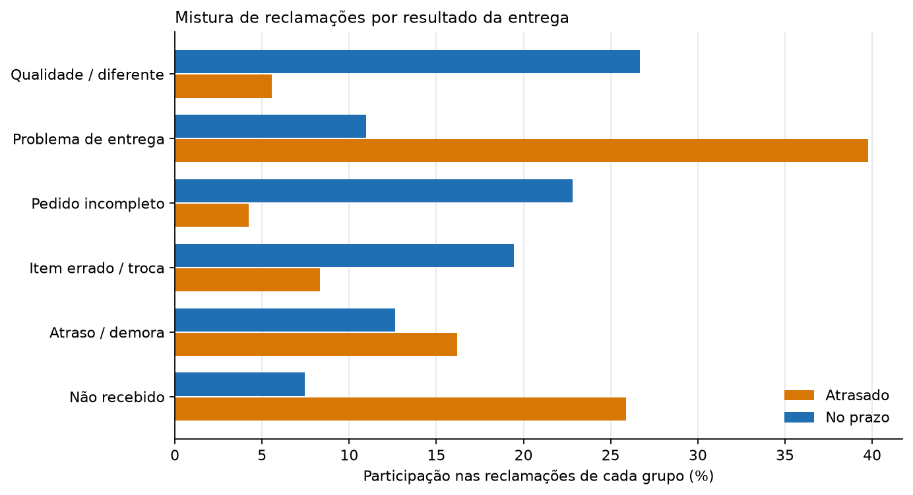

::: {.memo-head}
**Preparado para:** Diretor de Experiência do Cliente 
**Preparado por:** Anderson Tavares
:::

> Método, raciocínio completo e limitações estão no
> [relatório 03 · Voz do Cliente](03-voice-of-customer.qmd).

## Conclusão principal

Clientes de pedidos atrasados e de pedidos no prazo não estão tendo a mesma
conversa. **As reclamações de atrasados são sobre o pacote; as de pedidos no
prazo são sobre o produto.** Tratar "insatisfação do cliente" como um único
problema colocaria duas falhas operacionais diferentes na mesma fila.

## A descoberta

A partir de **9.139 reclamações escritas de 1–2 estrelas** sobre pedidos
entregues:

- **As reclamações de atrasados são de logística.** Problemas de entrega são
  **39,8%** das reclamações de atrasados contra **11,0%** das de pedidos no prazo
  (**+28,8 pp**). Não recebimento é **25,9%** contra **7,5%** (**+18,4 pp**), e
  demora é **16,2%** contra **12,6%** (**+3,6 pp**).
- **As reclamações de pedidos no prazo são de produto.** Qualidade ou "diferente
  do anunciado" é **26,7%** das reclamações no prazo contra **5,6%** das de
  atrasados (**−21,1 pp**). Pedido incompleto é **22,8%** contra **4,2%**
  (**−18,6 pp**), e item errado, defeito ou troca é **19,4%** contra **8,3%**
  (**−11,1 pp**).
- **A separação sobrevive ao agrupamento.** Entrega e não recebimento juntos são
  **65,7%** das reclamações de atrasados e **18,5%** das de pedidos no prazo. Três
  tópicos de produto são **18,1%** das reclamações de atrasados e **68,9%** das
  de pedidos no prazo. O tópico misto de demora (16,2% vs 12,6%) é reportado
  separadamente e não entra na logística.
- Todas as seis diferenças têm intervalos de 95% que excluem zero e q-valores de
  Benjamini–Hochberg abaixo de 0,001.

{#fig-mix fig-alt="Barras horizontais pareadas mostrando a participação de cada tópico nas reclamações de pedidos atrasados e no prazo. Entrega, não recebimento e demora dominam o grupo atrasado; qualidade, pedido incompleto e item errado dominam o grupo no prazo." fig-align="center"}

## O escopo, antes do resultado

Pedidos atrasados são **6,8%** das entregas mas **29,7%** do corpus de
reclamações. Eles são avaliados com mais frequência (57,6% contra 39,1%) e
avaliados mal com muito mais frequência (42,0% contra 7,2%). **Toda participação
acima é uma participação nas reclamações, não nos pedidos ou nos clientes.** O
conjunto de dados pode dizer sobre o que reclamaram os que reclamaram; não pode
dizer o que viveu a maioria silenciosa.

## Recomendação

**1. Separar a fila por causa, não por nota.** Encaminhar reclamações de pedidos
atrasados para a operação de entrega e reclamações de produto de pedidos no prazo
para catálogo, qualidade e embalagem. A maior diferença nos atrasados é entrega;
a maior diferença nos pedidos no prazo é qualidade do produto. Um único balde de
"baixa satisfação" esconde os dois.

**2. Não usar volume de avaliações como KPI de satisfação sem o denominador.** A
taxa de avaliação ela mesma muda com o desfecho. Reportar reclamações por pedido
entregue dentro de cada desfecho, ou manter a comparação composicional como esta
análise faz.

**3. Codificar manualmente uma amostra antes de usar operacionalmente.** Os seis
tópicos são um resumo derivado de modelo com rótulos subjetivos. Algumas centenas
de reclamações codificadas à mão estabeleceriam se as fronteiras entre "demora",
"problema de entrega" e "não recebido" são estáveis o suficiente para triagem.

## O que mudaria minha opinião

- **Se as reclamações de uma palavra tiverem outra mistura.** 98 comentários de
  1–2 estrelas são descartados por serem curtos demais; se fossem
  desproporcionalmente sobre uma falha, as participações mudariam.
- **Se a diferença desaparecer dentro de categoria de produto e valor do
  pedido.** Isso sugeriria que clientes de atrasados e de pedidos no prazo
  reclamam de cestas diferentes, não de experiências diferentes. Esta análise não
  condiciona à cesta.
- **Se a codificação manual discordar dos rótulos do modelo.** Então os tópicos
  são um auxílio de leitura, não um instrumento de medição, e a recomendação
  deveria se apoiar na amostra manual.
- **Se um identificador de transportadora ficar disponível.** Ele permitiria
  transformar "problema de entrega" em uma pergunta sobre responsável, em vez de
  uma categoria da linguagem do cliente. Este conjunto de dados não tem
  transportadora, rota nem armazém.
