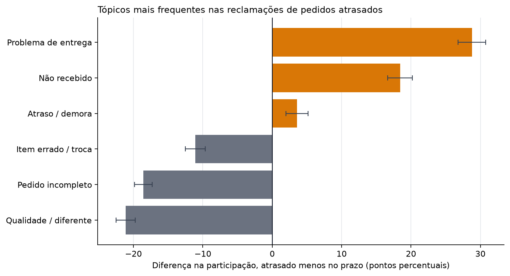
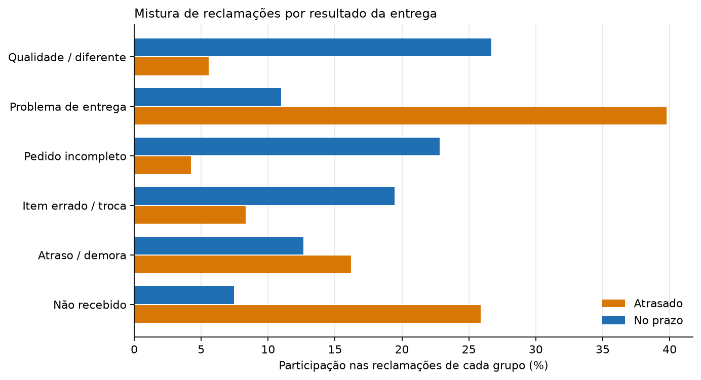

Este é o terceiro projeto sobre o conjunto de dados de e-commerce brasileiro da
Olist. O Projeto 01 mediu o atraso na entrega pelo lado do pedido e encontrou ali
o sinal mais forte de insatisfação. Este projeto lê o outro lado: o texto em
português que os clientes realmente escreveram.

A pergunta é **do que os clientes reclamam, e se isso muda quando o pacote chega
atrasado**. A resposta curta é que muda quase por completo. As reclamações de
pedidos atrasados são sobre o pacote. As reclamações de pedidos no prazo são sobre
o produto.

Todo número abaixo vem dos modelos testados em
`projects/01-retail-analytics/dbt_project` e é produzido por um único script,
`projects/03-voice-of-customer/scripts/analyze_reviews.py`, que escreve as tabelas
e figuras usadas nesta página.

---

## Resumo executivo

- **9.139 reclamações utilizáveis** foram escritas com nota 1–2 sobre pedidos
  entregues: 2.711 de pedidos atrasados e 6.428 de pedidos no prazo.
- **As reclamações de pedidos atrasados são quase todas sobre a entrega.**
  Problemas de entrega são **39,8%** das reclamações de atrasados contra **11,0%**
  das de pedidos no prazo (**+28,8 pp**). Não recebimento é **25,9%** contra
  **7,5%** (**+18,4 pp**), e demora é **16,2%** contra **12,6%** (**+3,6 pp**).
  Todos os intervalos excluem zero.
- **As reclamações de pedidos no prazo são quase todas sobre o produto.**
  Qualidade ou "diferente do anunciado" é **26,7%** das reclamações no prazo
  contra **5,6%** das de atrasados (**−21,1 pp**). Pedido incompleto é **22,8%**
  contra **4,2%** (**−18,6 pp**), e item errado, defeito ou troca é **19,4%**
  contra **8,3%** (**−11,1 pp**).
- **Agrupando os tópicos à mão, a separação fica mais nítida.** Os três tópicos de
  logística somam **81,9%** das reclamações de atrasados e **31,1%** das de
  pedidos no prazo. Os três tópicos de produto somam **18,1%** das reclamações de
  atrasados e **68,9%** das de pedidos no prazo. Esse agrupamento é um resumo do
  analista, não uma saída do modelo.
- **Isto descreve quem escreveu reclamações, não todos os compradores.** Pedidos
  atrasados são **6,8%** das entregas mas **29,7%** do corpus de reclamações,
  porque são mais avaliados e muito mais avaliados mal. O relatório compara a
  *mistura* das reclamações, e diz isso antes de mostrar qualquer resultado.

---

## 1. Quem está no corpus

Há 99.224 linhas de avaliação, mas a maioria dos pedidos não tem comentário
escrito, e os que têm são selecionados pelo desfecho. Restringindo a pedidos
entregues e à avaliação mais recente de cada pedido, chega-se à população abaixo.

```{=html}
<!-- Source: reports/review_scope.json -->
```

| Desfecho | Pedidos | Com comentário | Comentários de 1–2 estrelas |
|---|---:|---:|---:|
| No prazo | 89.941 | 35.138 (39,07%) | 6.490 (7,22%) |
| Atrasado | 6.535 | 3.762 (57,57%) | 2.747 (42,04%) |
| **Todos os entregues** | **96.476** | **38.900 (40,32%)** | **9.237 (9,57%)** |

**A seleção é o primeiro resultado, não uma ressalva acrescentada no final.** Um
pedido atrasado tem 1,47 vez mais chance de receber uma avaliação escrita do que
um pedido no prazo, e uma avaliação de 1–2 estrelas tem 5,8 vezes mais chance.
Pedidos atrasados são 6,8% das entregas mas 29,7% das reclamações que podemos ler.

Isso torna duas perguntas diferentes:

- *"Que fração dos pedidos atrasados gera reclamação?"* é uma pergunta sobre
  comportamento de avaliação, e este conjunto de dados só a responde para quem
  escolheu escrever.
- *"Entre as reclamações que existem, sobre o que são as de pedidos atrasados?"*
  é uma pergunta sobre o texto, e é a que este projeto responde.

O corpus é a segunda pergunta. Ele contém 9.237 comentários de 1–2 estrelas; 9.139
mantêm ao menos dois tokens após a normalização (98 veredictos de uma palavra como
*"ruim"* ou *"péssimo"* são descartados). Outras 3.039 avaliações de 1–2 estrelas
não têm comentário escrito e nunca entram.

---

## 2. Como os tópicos foram construídos

O método é deliberadamente simples e fixado antes de olhar o desfecho.

1. **Uma avaliação por pedido entregue**, a mais recente por `review_created_at` e
   depois `review_id`. É a mesma regra que `fct_orders` usa. Juntar as 99.224
   linhas de avaliação diretamente duplicaria 547 pedidos e inflaria todos os
   denominadores.
2. **Manter avaliações de 1–2 estrelas com comentário.** A nota é o sinal
   negativo. O modelo não precisa descobrir sentimento; precisa descrever sobre o
   que é a reclamação.
3. **Normalizar de forma conservadora.** Minúsculas, remoção de links, dígitos e
   pontuação, acentos preservados, e remoção de palavras funcionais do português
   e de nomes de vendedores. A negação fica: `não` é a diferença entre `recebi` e
   `não recebi`, e removê-la juntou "recebi" e "nunca recebi" em um ajuste
   anterior.
4. **Ajustar LDA com seis tópicos** sobre unigramas e bigramas (`min_df=20`,
   `max_df=0,5`, `random_state=0`, `max_iter=30`). O desfecho de entrega não é
   entrada; ele é juntado depois que os tópicos são ajustados.
5. **Atribuir cada reclamação ao tópico de maior peso** e rotular os tópicos a
   partir dos termos mais frequentes. O script verifica se cada tópico ainda
   contém seu termo âncora e falha se uma atualização de biblioteca reordenar os
   tópicos.

### Por que seis tópicos

Seis não foi escolhido pela perplexidade. A perplexidade cai à medida que tópicos
são adicionados e é menor em k=8, enquanto a coerência UMass — se os termos
principais de um tópico aparecem juntos no corpus — é maior em k=6 entre os sete
candidatos testados. A coerência é o critério porque a perplexidade
principalmente recompensa distribuir probabilidade sobre palavras frequentes; ela
não diz se um tópico é legível.

| Tópicos | Coerência UMass média (10 termos) | Perplexidade |
|---:|---:|---:|
| 4 | −2,699 | 333,05 |
| 5 | −2,699 | 332,39 |
| **6** | **−2,677** | **332,92** |
| 7 | −2,691 | 329,96 |
| 8 | −2,745 | 329,04 |
| 9 | −2,850 | 330,69 |
| 10 | −2,833 | 330,43 |

A margem sobre k=4, k=5 e k=7 é pequena: a coerência sozinha não prova que seis é
o número verdadeiro, apenas que é o melhor dos candidatos neste corpus e
pré-processamento. Os rótulos continuam sendo uma interpretação humana dos
termos, e dois pares se sobrepõem: "problema de entrega" e "demora" tratam de
entrega, e "não recebido" e "demora" compartilham vocabulário.

### Quão estáveis são os tópicos?

Reajustar com outras quatro sementes (1–4) dá um índice Rand ajustado médio de
**0,258** contra a partição publicada com semente 0 (faixa 0,234–0,283), e
sobreposição Jaccard média dos 10 termos principais de **0,413** (faixa
0,176–0,818 após correspondência um-a-um). Isso é baixo: a partição exata não é
estável entre inicializações. Os valores por tópico mostram o que sobrevive e o
que não sobrevive:

| Tópico | Jaccard médio dos termos principais entre sementes |
|---|---:|
| Qualidade / diferente | 0,255 |
| Não recebido | 0,581 |
| Pedido incompleto | 0,548 |
| Problema de entrega | 0,509 |
| Atraso / longa espera | 0,292 |
| Item errado / troca | 0,292 |

O agrupamento logística/produto é mais robusto que as fronteiras exatas. Em cada
semente alternativa, todo tópico de logística tem participação de atrasados entre
27% e 67%, enquanto todo tópico de produto fica entre 6% e 25%. A conclusão
principal — reclamações de atrasados tratam da entrega, reclamações no prazo
tratam do produto — sobrevive; os seis rótulos específicos e os percentuais exatos
não devem ser lidos como categorias fixas.

### Reclamações mistas e atribuição dura

O LDA retorna uma distribuição sobre tópicos para cada reclamação; as tabelas
acima usam apenas o maior peso. Isso é uma simplificação mensurável: **22,7%** das
reclamações têm o maior peso abaixo de 0,5, **7,5%** abaixo de 0,4, e **31,7%**
têm um segundo tópico em 0,3 ou mais. A entropia normalizada média é 0,522 numa
escala de 0–1. Uma reclamação sobre um pedido atrasado, danificado e incompleto
frequentemente tem massa substancial em mais de um tema.

Os rótulos foram verificados lendo as reclamações de maior peso de cada tópico.
Os temas são reconhecíveis no texto bruto: danificado ou diferente da foto
(qualidade), ainda esperando um mês depois (não recebido), pediu dois e recebeu um
(pedido incompleto), prazo vencido ou rastreio diz entregue mas nada chegou
(problema de entrega), "quase um mês, outros sites são mais rápidos" (atraso), e
voltagem ou item errado sem troca (item errado/troca). Essas paráfrases são
evidência qualitativa para os rótulos, não um substituto da comparação
quantitativa.

Usar a distribuição completa de tópicos, e não apenas o maior peso, leva à mesma
leitura. No corpus, os três tópicos de logística respondem por **75,1%** do peso
médio das reclamações de pedidos atrasados contra **36,9%** das reclamações no
prazo; os três tópicos de produto respondem por **24,9%** contra **63,1%**. As
diferenças por atribuição dura na tabela são maiores, mas a direção não depende
de forçar cada reclamação em um único tópico.

```{=html}
<!-- Source: reports/topic_terms.csv -->
```

| Tópico | Termos mais frequentes (após normalização) | Reclamações |
|---|---|---:|
| Qualidade ou diferente do anunciado | produto, veio, nao, qualidade, cor, gostei, diferente, quero | 1.866 |
| Problema de entrega (prazo ou transportadora) | produto, entregue, entrega, prazo, dia, chegou, não entregue, não chegou | 1.784 |
| Pedido incompleto (itens faltando) | comprei, recebi, apenas, dois, produtos, pedido, duas, nota | 1.581 |
| Item errado, defeito ou troca | produto, veio, comprei, contato, outro, troca, errado, defeito | 1.475 |
| Atraso e longa espera | produto, estou, recomendo, loja, entrega, não recomendo, compra, aguardando | 1.251 |
| Não recebido (ainda esperando) | recebi, não recebi, produto, ainda, recebi produto, ainda não, nao, produto ainda | 1.182 |

As palavras são evidência do que cada tópico trata, não uma explicação causal.
"Correios" aparece no tópico de problema de entrega, mas o conjunto de dados não
tem identificador de transportadora, então o tópico não estabelece quem causou o
atraso.

---

## 3. O que muda quando o pacote atrasa

A comparação é composicional: a participação de cada tópico nas reclamações de
atrasados contra sua participação nas reclamações de pedidos no prazo. Os dois
denominadores são populações diferentes (2.711 reclamações de atrasados e 6.428 de
pedidos no prazo), e a diferença é em pontos percentuais.

```{=html}
<!-- Source: reports/topic_prevalence.csv -->
```

| Tópico | Todas as reclamações | Participação em atrasados | Participação em no prazo | Diferença | IC 95% | q (BH) |
|---|---:|---:|---:|---:|---:|---:|
| Qualidade ou diferente do anunciado | 1.866 (20,4%) | 5,6% | 26,7% | −21,1 pp | −22,5 a −19,7 | < 0,001 |
| Problema de entrega (prazo ou transportadora) | 1.784 (19,5%) | 39,8% | 11,0% | +28,8 pp | +26,8 a +30,8 | < 0,001 |
| Pedido incompleto (itens faltando) | 1.581 (17,3%) | 4,2% | 22,8% | −18,6 pp | −19,8 a −17,3 | < 0,001 |
| Item errado, defeito ou troca | 1.475 (16,1%) | 8,3% | 19,4% | −11,1 pp | −12,5 a −9,7 | < 0,001 |
| Atraso e longa espera | 1.251 (13,7%) | 16,2% | 12,6% | +3,6 pp | +2,0 a +5,2 | < 0,001 |
| Não recebido (ainda esperando) | 1.182 (12,9%) | 25,9% | 7,5% | +18,4 pp | +16,7 a +20,2 | < 0,001 |

{#fig-gap fig-alt="Gráfico de barras horizontais da diferença na participação de cada tópico de reclamação entre pedidos atrasados e no prazo. Problema de entrega, não recebido e demora são positivos; qualidade, pedido incompleto e item errado são negativos. O intervalo de 95% de cada barra exclui zero." fig-align="center"}

{#fig-mix fig-alt="Barras horizontais pareadas mostrando a participação de cada tópico nas reclamações de pedidos atrasados e no prazo. Problema de entrega, não recebido e demora dominam o grupo atrasado; qualidade, pedido incompleto e item errado dominam o grupo no prazo." fig-align="center"}

**As reclamações de atrasados são sobre o pacote.** Problema de entrega, não
recebimento e demora juntos são 81,9% das reclamações de atrasados, contra 31,1%
das de pedidos no prazo. A maior diferença isolada é "problema de entrega", com
+28,8 pp. É o que o Projeto 01 encontrou nos carimbos de tempo de entrega, agora
dito nas palavras dos próprios clientes: quando um pedido atrasa, a reclamação é
sobre a entrega, não sobre a mercadoria.

**As reclamações de pedidos no prazo são sobre o produto.** Só qualidade ou
"diferente do anunciado" é 26,7% das reclamações no prazo. Pedido incompleto é
22,8%, e item errado, defeito ou troca é 19,4%. São 1.715, 1.466 e 1.249
reclamações, respectivamente, e ocorrem em pedidos que cumpriram o prazo. Quem
recebe a cor errada, um item faltando ou um produto danificado reclama do produto
mesmo quando o pacote chegou na data.

**A implicação operacional são duas filas, não uma.** Reduzir o atraso removeria
a maior fonte de reclamações de atrasados, mas não tocaria nas reclamações de
produto e completude que dominam o grupo no prazo. Os dois problemas têm donos e
correções diferentes. É uma conclusão mais útil do que uma única nota de
sentimento, e só é visível porque o corpus foi dividido por desfecho depois de os
tópicos serem ajustados.

---

## 4. O que os dados não sustentam

- **Nenhuma afirmação causal.** Um tópico ser mais comum entre reclamações de
  atrasados é uma associação entre um desfecho de entrega e o assunto de uma
  reclamação. Os dados não mostram que o atraso causou uma reclamação específica,
  e o corpus selecionado torna até a associação descritiva de quem reclama.
- **Nenhuma afirmação sobre todos os clientes.** 57,6% dos pedidos atrasados têm
  comentário, contra 39,1% dos pedidos no prazo. Quem escreve não é uma amostra
  aleatória, e nada aqui estima a mistura de reclamações da maioria silenciosa.
- **Nenhuma afirmação sobre experiência positiva.** Apenas avaliações de 1–2
  estrelas são modeladas. A análise diz do que reclamaram os insatisfeitos, não o
  que valorizaram os satisfeitos.
- **Tópicos são uma simplificação.** Seis tópicos, atribuição dura, recursos de
  saco de palavras, rótulos subjetivos e categorias sobrepostas. A verificação de
  estabilidade acima mostra que a partição exata não é estável, embora o
  agrupamento logística/produto seja. Uma reclamação sobre um pedido atrasado,
  danificado e incompleto é forçada em um único tópico, e 22,7% das reclamações
  têm o maior peso abaixo de 0,5. Outros valores de k produziriam uma partição
  diferente, não necessariamente errada.
- **Um marketplace e um período.** Olist, de setembro de 2016 a outubro de 2018.
  O vocabulário e a operação de entrega são específicos dele.
- **O rótulo é a promessa, não o escaneamento da transportadora.** `is_late`
  significa que o carimbo de entrega é posterior à data prometida. O conjunto de
  dados não tem identificador de transportadora, rota nem armazém, então
  "problema de entrega" não pode ser atribuído a um responsável.

---

## 5. Reproduzir

```bash
uv run python tasks.py topics     # ajusta o modelo, escreve tabelas e figuras
uv run pytest                     # 40 testes, sem banco de dados nem rede
```

O script lê os modelos construídos, então a ordem no pipeline é
`load → dbt-build → topics`. Ele escreve:

- `projects/03-voice-of-customer/reports/review_scope.json` — escopo e metadados
  do modelo, incluindo perplexidade e peso médio dos tópicos por desfecho.
- `projects/03-voice-of-customer/reports/topic_terms.csv` — os doze termos
  principais de cada tópico.
- `projects/03-voice-of-customer/reports/topic_prevalence.csv` — a tabela acima,
  com p-valores exatos e limites de confiança.
- `projects/03-voice-of-customer/reports/topic_selection.csv` — coerência e
  perplexidade para k=4–10; o script para se a coerência deixar de escolher k=6.
- `site/reports/03-voice-of-customer/figures/*.png` — as duas figuras, em inglês
  e português.

O modelo é determinístico dada a versão fixada do scikit-learn, a semente e o
corpus fixo. As âncoras dos tópicos são verificadas em tempo de execução, então
uma atualização de biblioteca que reordene os tópicos faz a tarefa falhar em vez
de renomeá-los em silêncio.
