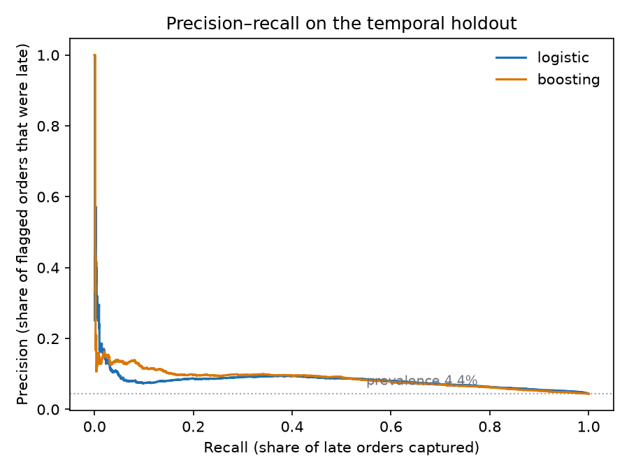
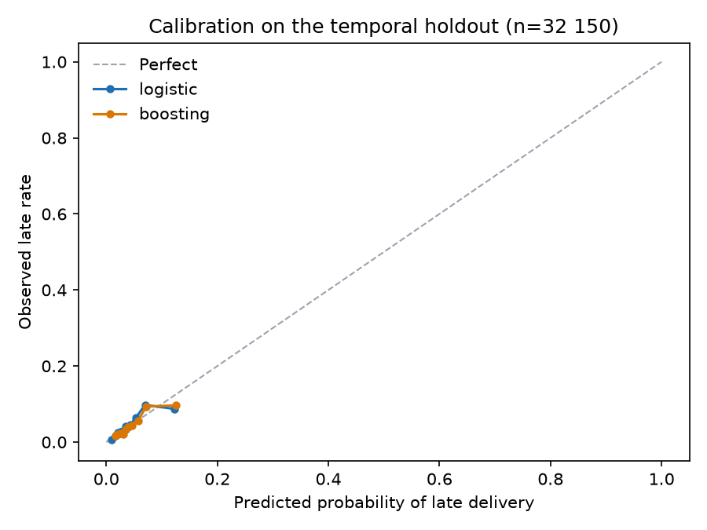

This is the second project on the Olist Brazilian e-commerce dataset. The
[first](../01-retail-analytics/01-business-analytics.qmd) established that late
delivery is the strongest signal of customer dissatisfaction in the marketplace
and that the delay concentrates on the São Paulo → Rio lane. This project asks
the forward-looking question: **at the moment the order is placed, can we rank
orders by their risk of arriving late?**

Every number below comes from `projects/02-late-delivery`, trained on the dbt
mart `mart_order_features`. The trained model is not committed; the metrics and
figures are, and `uv run python tasks.py train` rebuilds them.

---

## Executive summary

- **The ranking has a modest signal, not a strong one.** On a temporal holdout of
  32,150 delivered orders, logistic regression reaches **ROC AUC 0.685** (95%
  bootstrap interval 0.671–0.698) and **average precision 0.082** (0.076–0.091)
  against a 4.42% late rate. Flagging the riskiest 10% captures **19.7% of late
  orders** at **8.7% precision — 1.97× the base rate**.
- **The earlier 2.35× lift was inflated by a subtle selection rule.** The previous
  version trained on purchases right up to the test cutoff and kept only orders
  already delivered. That removed 3,852 orders with a **39.1% late rate**, exactly
  the slow orders the model is supposed to find. Training now stops three months
  before the test cutoff, so the training sample is not selected on delivery
  speed. The honest number is smaller.
- **The model class is not settled.** Logistic regression won the rolling-origin
  comparison (mean AP 0.119 vs 0.108), while gradient boosting scored slightly
  better on the final holdout (AP 0.087 vs 0.082). A paired bootstrap over
  holdout rows puts the logistic-minus-boosting AP difference at **−0.0048
  (95% interval −0.0122 to +0.0036)**. The interval includes zero: this holdout
  does not distinguish them.
- **The score is roughly calibrated in level but not a reliable probability.**
  Mean prediction is 4.26% against 4.42% observed; the logistic calibration slope
  is 0.82 with intercept −0.47. The ranking is compressed and the score should
  not be read as a probability for an individual order.
- **Promise length and geography dominate.** Permutation importance ranks
  `promise_days` first, then `customer_state` and `seller_state`. Basket value,
  freight, weight, payment and category add little.
- **This is not a deployment-ready product.** The extreme tail is not enriched:
  precision at the top 5% (7.7%) is *lower* than at the top 10% (8.7%). Without a
  cost model and a prospective pilot, the right conclusion is a research
  prototype, not an operating queue.

---

## 1. The feature contract

The model may only use information that exists when the order is placed. That is
enforced by an explicit allow-list in
`projects/02-late-delivery/src/late_delivery/features.py`, not by dropping a few
obvious columns: a new mart column fails closed until someone adds it on purpose.

| Group | Features |
|---|---|
| Timing of the purchase | month, day of week, hour, weekend flag |
| The promise | `promise_days` (promised date − purchase date) |
| Geography | customer state, seller state, same-state flag |
| Order composition | category, item / product / seller counts, item value, freight, order value, freight share, weight, volume, photos, missing dimensions |
| Payment | payment count, maximum installments, credit card / boleto / voucher flags |

Deliberately excluded: approval time, carrier hand-off, delivery date, delivery
duration, days late, the label itself, the review score, and order status. Every
one of those is observed after checkout. Arrival time would predict lateness
almost perfectly, which is exactly why including it would make the result
worthless as a forecast.

`order_status` and `delivered_to_customer_at` are present in the mart only to
decide whether a training label was observable at the cutoff. They are forbidden
in the feature matrix and a unit test enforces that.

Two consequences are visible in the mart. `seller_state` is null for 1,285
orders with more than one seller, because a multi-seller order has no single
origin; `same_state` is null for the same rows. Both are imputed inside the
pipeline rather than guessed. For orders with several categories, the mart keeps
the most frequent category and breaks ties alphabetically.

---

## 2. Evaluation design

**Target:** `is_late`, defined in Project 01 as the delivery date being strictly
after the promised date. Orders without an observed delivery timestamp have no
label and are excluded. That is not the same as “never delivered”: the 2,965
excluded orders are mostly still in flight or cancelled at the end of the
dataset (1,107 shipped, 619 cancelled, 609 unavailable, 314 invoiced, 301
processing, 8 delivered with an incomplete timestamp, and a few earlier
statuses).

**Training window and label maturity.** Training uses purchases before
**2018-01-01** and deliveries before **2018-04-01**. The three-month gap is the
point. A naive rule — purchase before April, keep only delivered orders — looks
reasonable but drops every order that was still in transit on 1 April. Those
3,852 orders are not a random subset: **39.1% were late**. Removing them makes
the training set look much easier than the population it is meant to predict.
After the gap, the mature training set is **43,691 orders with a 5.61% late
rate**. Seven purchases before January that arrived after April are excluded
from training; all seven were late.

**Validation slice.** January–March 2018 (20,628 orders, 12.89% late) is kept as
a retrospective description only. It uses eventual labels and is not used to fit
the selected model or to choose between models. The high late rate in that period
is the 2018-02/03 backlog, and it is one reason a single holdout is not enough.

**Test:** purchases on or after **2018-04-01** with an observed label: **32,150
orders, 4.42% late**. Labels are eventual, not censored at the horizon; every
order with an outcome is scored.

**Model selection:** rolling origin. At 2017-07-01, 2017-10-01 and 2018-01-01,
each model is fitted on labels matured three months before the origin and scored
on the next three months. All orders with an eventual label in that window are
scored. Average precision across the three origins selects logistic regression
(**0.119 vs 0.108** for boosting). The final model is refit on the full mature
training set and evaluated once on the April–August holdout. Both models are
reported on the holdout as a sensitivity check, not used to re-select.

**Metrics:** ROC AUC and average precision for ranking; Brier score and a
calibration summary for probabilities; precision, recall and lift at 5%, 10% and
20% review capacities. The base rate is 4.42%, so accuracy is useless here —
predicting “not late” for every order is 95.6% accurate.

---

## 3. Results

| Model | ROC AUC | Avg. precision | Brier | Top-10% precision | Top-10% recall | Lift |
|---|---:|---:|---:|---:|---:|---:|
| Logistic regression (selected) | 0.685 | 0.082 | 0.0418 | 8.7% | 19.7% | 1.97× |
| Gradient boosting | 0.679 | 0.087 | 0.0416 | 9.6% | 21.8% | 2.18× |
| Constant (training prevalence) | — | — | 0.0424 | — | — | — |
| Customer-state rate | — | — | 0.0424 | 5.4% | 12.2% | 1.22× |

A constant score cannot rank, so it has no meaningful top-decile metrics. Its
Brier score remains a valid check on the probability level.

The paired bootstrap is the right comparison because both models score the same
orders. For average precision the logistic-minus-boosting difference is
**−0.0048 (95% interval −0.0122 to +0.0036; 13.8% of resamples favour
logistic)**. For ROC AUC the difference is **+0.0065 (−0.0054 to +0.0194)**.
Neither interval excludes zero. The earlier test-set difference was larger; after
removing the training-selection bias, the two defaults are not distinguishable
on this holdout.

{#fig-pr fig-alt="Precision-recall curves for logistic regression and gradient boosting on the 32,150-order temporal holdout. Both sit above the 4.42 percent base-rate line, with gradient boosting slightly higher for most recall values." fig-align="center"}

### Review capacity

| Capacity | Orders reviewed | Late orders found | Precision | Recall | Lift |
|---|---:|---:|---:|---:|---:|
| 5% | 1,608 | 124 | 7.7% | 8.7% | 1.74× |
| 10% | 3,215 | 280 | 8.7% | 19.7% | 1.97× |
| 20% | 6,430 | 594 | 9.2% | 41.8% | 2.09× |

The capacity curve is **not monotone**. Precision at the top 5% is lower than at
the top 10%, which means the very highest scores are not the purest. That is a
warning against treating the model as a precise shortlist: reviewing the top
1,600 orders finds a smaller share of late orders than reviewing the next 1,600.
The 10% slice is the best of the three, but the gain over the state baseline is
modest (8.7% against 5.4%).

Bootstrap intervals (500 resamples) put the 10% operating point at 7.7–9.6%
precision, 17.7–21.7% recall and 1.77–2.17× lift. Those intervals describe
sampling noise within this holdout; they do not cover the regime change between
periods.

---

## 4. Calibration

{#fig-cal fig-alt="Calibration plot comparing predicted and observed late-delivery rates in ten score bins. Both models follow the diagonal more closely than in the earlier version, with some compression at the high end." fig-align="center"}

The holdout's late rate is 4.42%; the selected model predicts 4.26% on average.
A logistic recalibration fit on the holdout gives an intercept of **−0.47** and a
slope of **0.82** (logit scale). The slope below one means the scores are
compressed: high scores are not high enough and low scores are not low enough.
The level is close, but the probability attached to an individual order is still
not trustworthy.

The practical reading: **the score is a ranking, not a probability.** If a
probability is needed for a customer-facing decision, it has to be recalibrated
on recent delivered orders and monitored as the regime moves. The earlier
version of this analysis overpredicted badly because it trained on a
delivery-speed-selected sample; that particular bias is gone, but a single
holdout cannot establish calibration stability.

---

## 5. Stability across time

A single holdout can hide how much the result depends on the period. The monthly
breakdown shows real variation:

| Purchase month | Orders | Late rate | ROC AUC | Avg. precision | Top-10% recall |
|---|---:|---:|---:|---:|---:|
| 2018-04 | 6,798 | 4.50% | 0.776 | 0.155 | 42.5% |
| 2018-05 | 6,749 | 6.56% | 0.663 | 0.123 | 25.3% |
| 2018-06 | 6,096 | 1.16% | 0.793 | 0.054 | 38.0% |
| 2018-07 | 6,156 | 3.38% | 0.619 | 0.066 | 17.3% |
| 2018-08 | 6,351 | 6.19% | 0.602 | 0.086 | 10.4% |

Average precision tracks the late rate: June looks weak partly because there was
almost nothing to find. The more concerning pattern is July–August, where AUC
falls to 0.60–0.62 and the top decile captures only 10–17% of late orders.

Rolling-origin evaluation tells the same story over a longer window. At each
origin the model is trained on labels matured three months before that date and
scored on the next three months; test outcomes are eventual, so no late order is
dropped for arriving after the horizon:

| Origin | Training cutoff | Train orders | Test orders | Test late rate | ROC AUC | Avg. precision | Top-10% recall |
|---|---:|---:|---:|---:|---:|---:|---:|
| 2017-07 | 2017-04 | 5,207 | 12,215 | 3.37% | 0.623 | 0.056 | 21.6% |
| 2017-10 | 2017-07 | 14,201 | 17,279 | 8.69% | 0.589 | 0.117 | 15.5% |
| 2018-01 | 2017-10 | 26,418 | 20,628 | 12.89% | 0.605 | 0.184 | 17.6% |

The ranking is positive in every window but weak: AUC 0.59–0.62, average
precision 0.056–0.184. These test populations are all orders purchased in the
window with an eventual label; they are not censored on delivery time. The
training sets are smaller than the headline because of the three-month maturity
gap. That is the honest uncertainty around a single headline number, and it
argues for monitoring rather than a one-off deployment claim.

---

## 6. What the model is using

Permutation importance shuffles one raw feature at a time and measures the drop
in average precision on the holdout. Shuffling at the raw-feature level keeps a
categorical variable as one concept instead of the dozens of one-hot columns it
becomes inside the pipeline.

| Feature | Drop in average precision |
|---|---:|
| `promise_days` | 0.026 |
| `customer_state` | 0.017 |
| `seller_state` | 0.003 |
| `category` | 0.002 |
| `items_value` | 0.002 |
| `avg_weight_grams` | 0.002 |
| `seller_count` | 0.001 |
| `avg_volume_cm3` | 0.001 |

The list is short and it matches Project 01's finding. The promise is the
strongest single input, and geography carries most of the rest. Basket value,
freight, weight, payment method and category add almost nothing once those are
known. `purchase_month` and `purchase_hour` are near zero or slightly negative,
which means shuffling them did not hurt this holdout.

That does **not** mean “widen the promise and lateness disappears”. Project 01
showed the promise is set per lane and is shorter on the São Paulo → Rio corridor
than on longer routes; `promise_days` is partly the marketplace's own expectation
of difficulty. The model is exploiting that expectation, not identifying a lever
that can be changed independently. The causal question remains the operational
one from Project 01: why the crossing takes so long.

---

## 7. Limitations

- **The signal is modest.** AUC 0.685 and top-decile lift 1.97× are not enough to
  justify deployment without a cost model and a prospective pilot. The top 5%
  is less precise than the top 10%, so the model should not be used as a narrow
  shortlist.
- **One holdout, and a moving regime.** The test period contains the 2018-02/03
  backlog and the abrupt improvement after it. Monthly AUC ranges from 0.60 to
  0.79 and rolling origins from 0.59 to 0.62. A production decision needs a
  longer rolling evaluation, not this single split.
- **Excluded orders are not a random sample.** 2,965 orders have no observable
  late label. Most are in flight or cancelled at the end of the dataset. The
  model is evaluated on delivered orders, so it says nothing about whether a
  cancelled order would have been late.
- **The training gap costs data.** Training on purchases before 2018-01-01
  avoids delivery-speed selection but discards January–March 2018, the period
  with the highest late rate. A production system would retrain as labels
  mature, not freeze at one cutoff.
- **No carrier or warehouse identifier.** The dataset stops at seller and state.
  The most plausible operational cause of lateness is therefore not in the model.
- **The label is the promise, not the customer's expectation.** An order can be
  “late” against an aggressive promise and still arrive when the customer
  expected it. Project 01 shows the review gap is real, but the label inherits
  the promise's definition.
- **Multi-seller orders lose their origin.** 1,285 orders have no single seller
  state. Imputation keeps them in the evaluation but weakens geography for those
  rows.
- **Feature importance is associational.** Shuffling `promise_days` breaks its
  correlation with lane difficulty, so the drop is not the causal effect of
  changing the promise.
- **No cost model.** The dataset has no intervention cost, refund value or
  margin. The capacity framing avoids inventing one; a real deployment would
  choose capacity by comparing the cost of reviewing an order with the cost of a
  late delivery.

---

## 8. Reproducing it

```bash
uv run python tasks.py db-up
uv run python tasks.py data
uv run python tasks.py load
uv run python tasks.py dbt-build
uv run python tasks.py train
```

`train` writes `projects/02-late-delivery/reports/model_metrics.json`, the
permutation-importance table and the two figures above. The feature contract,
split and evaluation helpers have unit tests in
`projects/02-late-delivery/tests/test_modeling.py`, including checks that no
forbidden post-purchase column can enter the feature list, that training stops
three months before the test cutoff, and that rolling-origin test windows are
not censored on delivery time.
