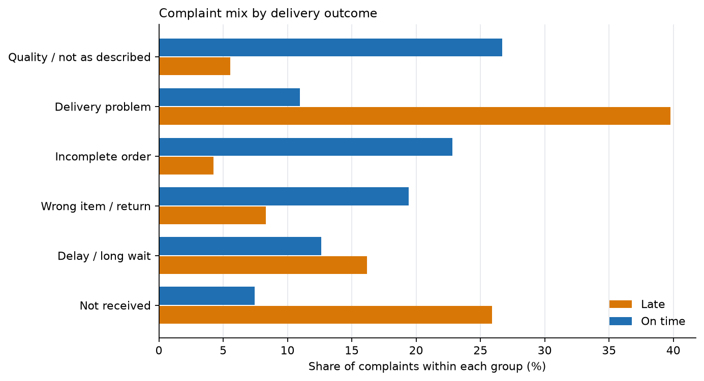

::: {.memo-head}
**Prepared for:** Head of Customer Experience 
**Prepared by:** Anderson Tavares
:::

> Method, full reasoning and limitations are in the
> [03 · Voice of the Customer report](03-voice-of-customer.qmd).

## Bottom line

Late and on-time customers are not having the same conversation. **Late
complaints are about the parcel; on-time complaints are about the product.**
Treating "customer dissatisfaction" as one problem would put two different
operational failures in the same queue.

## The finding

From **9,139 written 1–2 star complaints** on delivered orders:

- **Late complaints are logistics.** Delivery problems are **39.8%** of late
  complaints against **11.0%** of on-time complaints (**+28.8 pp**). Non-receipt
  is **25.9%** against **7.5%** (**+18.4 pp**), and delay is **16.2%** against
  **12.6%** (**+3.6 pp**).
- **On-time complaints are product.** Quality or "not as described" is **26.7%**
  of on-time complaints against **5.6%** of late ones (**−21.1 pp**). Incomplete
  orders are **22.8%** against **4.2%** (**−18.6 pp**), and wrong item, defect or
  return is **19.4%** against **8.3%** (**−11.1 pp**).
- **The split survives aggregation.** Three logistics topics are **81.9%** of
  late complaints and **31.1%** of on-time complaints. Three product topics are
  **18.1%** of late complaints and **68.9%** of on-time complaints.
- All six differences have 95% intervals that exclude zero and
  Benjamini–Hochberg q-values below 0.001.

{#fig-mix fig-alt="Paired horizontal bars showing each topic's share of late complaints and of on-time complaints. Delivery, non-receipt and delay dominate the late group; quality, incomplete order and wrong item dominate the on-time group." fig-align="center"}

## The scope, stated before the result

Late orders are **6.8%** of deliveries but **29.7%** of the complaint corpus.
They are reviewed more often (57.6% against 39.1%) and reviewed badly far more
often (42.0% against 7.2%). **Every share above is a share of complaints, not of
orders or customers.** The dataset can say what complainers complained about; it
cannot say what the silent majority experienced.

## Recommendation

**1. Split the queue by cause, not by star rating.** Route late-order complaints
to delivery operations and on-time product complaints to catalogue, quality and
packing. The largest late gap is delivery; the largest on-time gap is product
quality. A single "low satisfaction" bucket hides both.

**2. Do not use review volume as a satisfaction KPI without the denominator.**
The review rate itself moves with the outcome. Report complaints per delivered
order within each outcome, or keep the comparison compositional as this analysis
does.

**3. Human-code a sample before operational use.** The six topics are a
model-derived summary with subjective labels. A few hundred manually coded
complaints would establish whether the boundaries between "delay", "delivery
problem" and "not received" are stable enough for triage.

## What would change my mind

- **If one-word complaints have a different mix.** 98 low-star comments are
  dropped for being too short; if they were disproportionately about one failure,
  the shares would move.
- **If the gap disappears within product category and order value.** That would
  suggest late and on-time complainers are complaining about different baskets
  rather than different experiences. This analysis does not condition on basket.
- **If manual coding disagrees with the model labels.** Then the topics are a
  useful reading aid, not a measurement instrument, and the recommendation should
  rest on the manual sample instead.
- **If a carrier identifier becomes available.** It would let "delivery problem"
  become a responsible-party question rather than a customer-language category.
  This dataset has no carrier, route or warehouse field.
