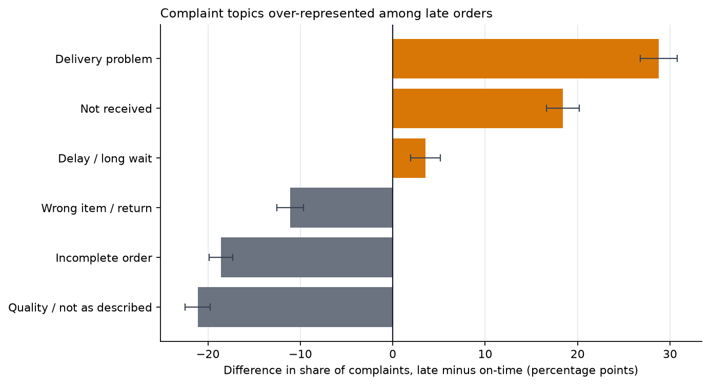
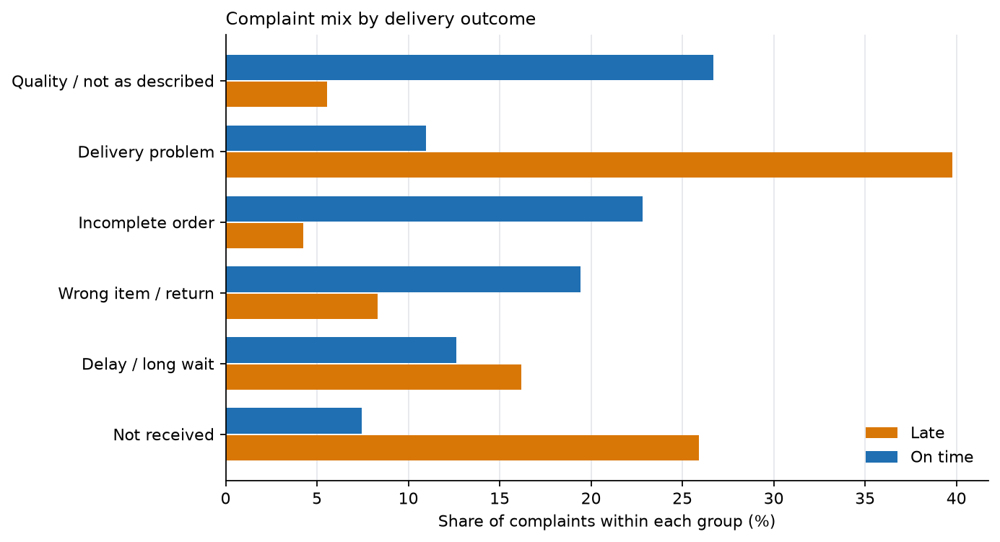

This is the third project on the Olist Brazilian e-commerce dataset. Project 01
measured late delivery from the order side and found it was the strongest signal
of dissatisfaction. This project reads the other side: the Portuguese text that
customers actually wrote.

The question is **what customers complain about, and whether that changes when
the parcel arrives late**. The short answer is that it changes almost completely.
Late complaints are about the parcel. On-time complaints are about the product.

Every number below comes from the tested marts in
`projects/01-retail-analytics/dbt_project` and is produced by one script,
`projects/03-voice-of-customer/scripts/analyze_reviews.py`. The script writes the
tables and figures this page uses.

---

## Executive summary

- **9,139 usable complaints** were written on 1–2 stars about delivered orders:
  2,711 from late orders and 6,428 from on-time orders.
- **Late complaints are overwhelmingly about delivery.** Delivery problems are
  **39.8%** of late complaints against **11.0%** of on-time complaints
  (**+28.8 pp**). Non-receipt is **25.9%** against **7.5%** (**+18.4 pp**), and
  delay is **16.2%** against **12.6%** (**+3.6 pp**). Every interval excludes
  zero.
- **On-time complaints are overwhelmingly about the product.** Quality or "not
  as described" is **26.7%** of on-time complaints against **5.6%** of late ones
  (**−21.1 pp**). Incomplete orders are **22.8%** against **4.2%** (**−18.6 pp**),
  and wrong item, defect or return is **19.4%** against **8.3%** (**−11.1 pp**).
- **Grouping the topics by hand makes the split starker.** The three logistics
  topics account for **81.9%** of late complaints and **31.1%** of on-time
  complaints. The three product topics account for **18.1%** of late complaints
  and **68.9%** of on-time complaints. That grouping is an analyst's summary, not
  a model output.
- **This is a description of people who wrote complaints, not of all buyers.**
  Late orders are **6.8%** of deliveries but **29.7%** of the complaint corpus,
  because late orders are both more likely to be reviewed and much more likely to
  be reviewed badly. The report compares the *mix* of complaints, and says so
  before showing any result.

---

## 1. Who is in the corpus

There are 99,224 review rows, but most orders have no written comment, and the
ones that do are selected by the outcome. Restricting to delivered orders and to
the latest review per order gives the population below.

```{=html}
<!-- Source: reports/review_scope.json -->
```

| Outcome | Orders | With a comment | 1–2 star comments |
|---|---:|---:|---:|
| On time | 89,941 | 35,138 (39.07%) | 6,490 (7.22%) |
| Late | 6,535 | 3,762 (57.57%) | 2,747 (42.04%) |
| **All delivered** | **96,476** | **38,900 (40.32%)** | **9,237 (9.57%)** |

**The selection is the first finding, not a caveat added at the end.** A late
order is 1.47 times as likely to receive a written review as an on-time order,
and a low-star review is 5.8 times as likely. Late orders are 6.8% of deliveries
but 29.7% of the complaints we can read.

That makes two questions different:

- *"What fraction of late orders produce a complaint?"* is a question about
  review behaviour, and this dataset answers it only for people who chose to
  write.
- *"Among the complaints that exist, what are late complaints about?"* is a
  question about the text, and it is the one this project answers.

The corpus is the second question. It contains 9,237 low-star comments; 9,139
retain at least two tokens after normalisation (98 one-word verdicts such as
*"ruim"* or *"péssimo"* are dropped). A further 3,039 low-star reviews carry no
written comment at all and never enter.

---

## 2. How the topics were built

The method is deliberately simple and fixed before looking at the outcome.

1. **One review per delivered order**, the latest by `review_created_at` and then
   `review_id`. This is the same rule `fct_orders` uses. Joining all 99,224 review
   rows directly would double-count 547 orders and inflate every denominator.
2. **Keep 1–2 star reviews with a comment.** The star rating is the negative
   signal. The model is not asked to discover sentiment; it is asked to describe
   what the complaint is about.
3. **Normalise conservatively.** Lowercase, remove links, digits and punctuation,
   keep accents, and drop Portuguese function words plus seller names. Negation
   stays: `não` is the difference between `recebi` and `não recebi`, and removing
   it merged "received" and "never received" in an earlier fit.
4. **Fit LDA with six topics** on unigrams and bigrams (`min_df=20`,
   `max_df=0.5`, `random_state=0`, `max_iter=30`). The delivery outcome is not an
   input; it is joined after the topics are fitted.
5. **Assign each complaint to its highest-weight topic** and label the topics
   from their top terms. The script checks that every topic still contains its
   anchor term and fails if a library upgrade reorders them.

Six topics was a judgement made by reading the terms and sample comments, not an
estimate of the one true number. Perplexity on the fitted corpus is 332.92; it is
reported as a fit statistic, not as proof that six is optimal. The labels are
subjective and two pairs overlap: "delivery problem" and "delay" both concern
delivery, and "not received" and "delay" share vocabulary.

```{=html}
<!-- Source: reports/topic_terms.csv -->
```

| Topic | Most frequent terms (after normalisation) | Complaints |
|---|---|---:|
| Product quality or not as described | produto, veio, nao, qualidade, cor, gostei, diferente, quero | 1,866 |
| Delivery problem (promise or carrier) | produto, entregue, entrega, prazo, dia, chegou, não entregue, não chegou | 1,784 |
| Incomplete order (missing items) | comprei, recebi, apenas, dois, produtos, pedido, duas, nota | 1,581 |
| Wrong item, defect or return | produto, veio, comprei, contato, outro, troca, errado, defeito | 1,475 |
| Delay and long wait | produto, estou, recomendo, loja, entrega, não recomendo, compra, aguardando | 1,251 |
| Not received (still waiting) | recebi, não recebi, produto, ainda, recebi produto, ainda não, nao, produto ainda | 1,182 |

The words are evidence of what each topic is about, not a causal explanation.
"Correios" appears in the delivery-problem topic, but the dataset has no carrier
identifier, so the topic cannot establish who caused a delay.

---

## 3. What changes when the parcel is late

The comparison is compositional: each topic's share of late complaints against
its share of on-time complaints. The two denominators are different populations
(2,711 late complaints and 6,428 on-time complaints), and the difference is in
percentage points.

```{=html}
<!-- Source: reports/topic_prevalence.csv -->
```

| Topic | All complaints | Share of late | Share of on-time | Difference | 95% CI | q (BH) |
|---|---:|---:|---:|---:|---:|---:|
| Product quality or not as described | 1,866 (20.4%) | 5.6% | 26.7% | −21.1 pp | −22.5 to −19.7 | < 0.001 |
| Delivery problem (promise or carrier) | 1,784 (19.5%) | 39.8% | 11.0% | +28.8 pp | +26.8 to +30.8 | < 0.001 |
| Incomplete order (missing items) | 1,581 (17.3%) | 4.2% | 22.8% | −18.6 pp | −19.8 to −17.3 | < 0.001 |
| Wrong item, defect or return | 1,475 (16.1%) | 8.3% | 19.4% | −11.1 pp | −12.5 to −9.7 | < 0.001 |
| Delay and long wait | 1,251 (13.7%) | 16.2% | 12.6% | +3.6 pp | +2.0 to +5.2 | < 0.001 |
| Not received (still waiting) | 1,182 (12.9%) | 25.9% | 7.5% | +18.4 pp | +16.7 to +20.2 | < 0.001 |

{#fig-gap fig-alt="Horizontal bar chart of the difference in each complaint topic's share between late and on-time orders. Delivery problem, not received and delay are positive; quality, incomplete order and wrong item are negative. Every bar's 95% interval excludes zero." fig-align="center"}

{#fig-mix fig-alt="Paired horizontal bars showing each topic's share of late complaints and of on-time complaints. Delivery problem, not received and delay dominate the late group; quality, incomplete order and wrong item dominate the on-time group." fig-align="center"}

**The late complaints are about the parcel.** Delivery problem, non-receipt and
delay together are 81.9% of late complaints, against 31.1% of on-time complaints.
The largest single gap is "delivery problem" at +28.8 pp. This is what Project 01
found from delivery timestamps, now said in the customers' own words: when an
order is late, the complaint is about the delivery, not about the merchandise.

**The on-time complaints are about the product.** Quality or "not as described"
alone is 26.7% of on-time complaints. Incomplete orders are 22.8%, and wrong
item, defect or return is 19.4%. These are 1,715, 1,466 and 1,249 complaints
respectively, and they occur on orders that met the promise. A customer who
receives the wrong colour, a missing item or a damaged product complains about
the product even when the parcel arrived on time.

**The operational implication is two queues, not one.** Reducing lateness would
remove the largest source of late complaints, but it would not touch the product
and completeness complaints that dominate the on-time group. The two problems
have different owners and different fixes. That is a more useful conclusion than
a single sentiment score, and it is visible only because the corpus was split by
outcome after the topics were fitted.

---

## 4. What the data cannot support

- **No causal claim.** A topic being more common among late complaints is an
  association between a delivery outcome and the subject of a complaint. The data
  cannot show that lateness caused a particular complaint, and the selected
  corpus makes even the association descriptive of complainers.
- **No claim about all customers.** 57.6% of late orders have a comment against
  39.1% of on-time orders. The people who write are not a random sample, and
  nothing here estimates the complaint mix of the silent majority.
- **No claim about positive experience.** Only 1–2 star reviews are modelled.
  The analysis says what dissatisfied people complained about, not what satisfied
  people valued.
- **Topics are a simplification.** Six topics, hard assignment, bag-of-words
  features, subjective labels, and overlapping categories. A complaint about a
  late, damaged, incomplete order is forced into one topic. Different values of
  k would produce a different but not necessarily wrong partition.
- **One marketplace and one period.** Olist, September 2016 to October 2018. The
  vocabulary and the delivery operation are specific to it.
- **The label is the promise, not the carrier scan.** `is_late` means the
  delivered timestamp is after the promised date. The dataset has no carrier
  identifier, no route and no warehouse, so "delivery problem" cannot be assigned
  to a responsible party.

---

## 5. Reproduce it

```bash
uv run python tasks.py topics     # fit the model, write tables and figures
uv run pytest                     # 25 tests, no database or network needed
```

The script reads the built marts, so the pipeline order is
`load → dbt-build → topics`. It writes:

- `projects/03-voice-of-customer/reports/review_scope.json` — scope and model
  metadata, including perplexity and mean topic weight by outcome.
- `projects/03-voice-of-customer/reports/topic_terms.csv` — the twelve top terms
  for each topic.
- `projects/03-voice-of-customer/reports/topic_prevalence.csv` — the table above,
  with exact p-values and confidence bounds.
- `site/reports/03-voice-of-customer/figures/*.png` — the two figures, in English
  and Portuguese.

The model is deterministic given the pinned scikit-learn version, the seed and
the fixed corpus. The topic anchors are checked at runtime, so a library upgrade
that reorders the topics fails the task instead of silently relabelling them.
